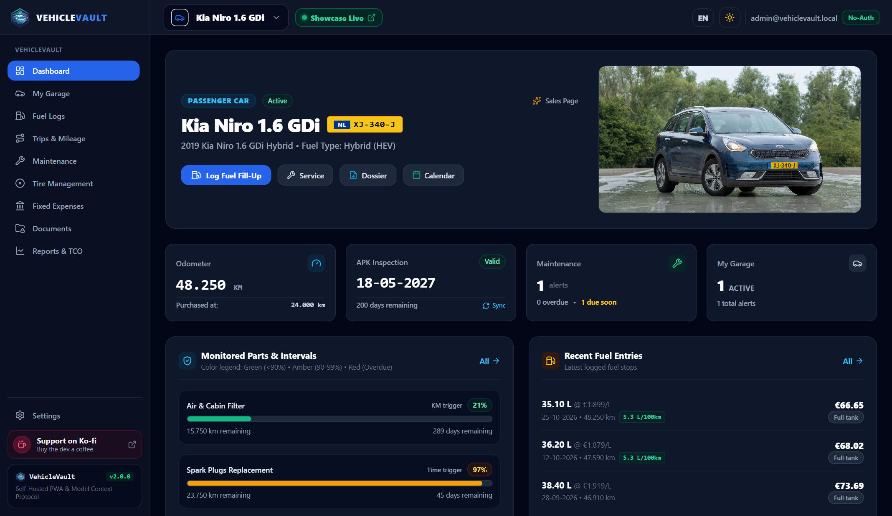
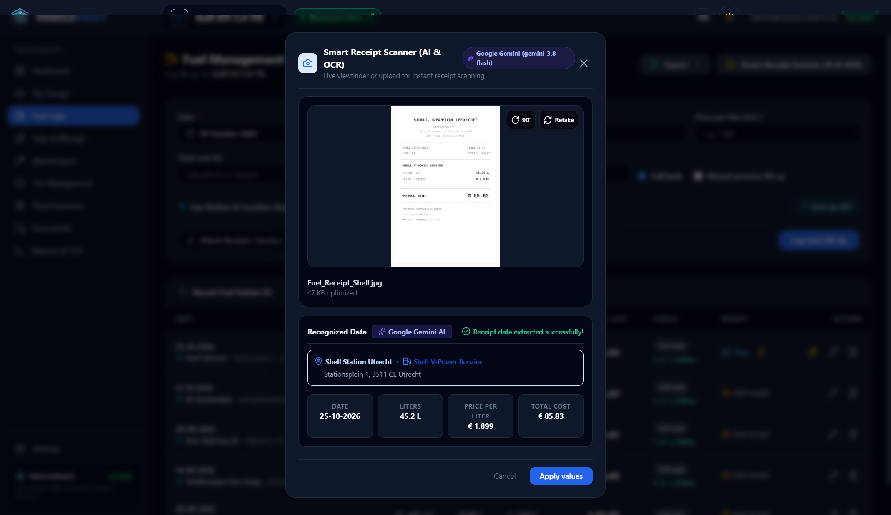
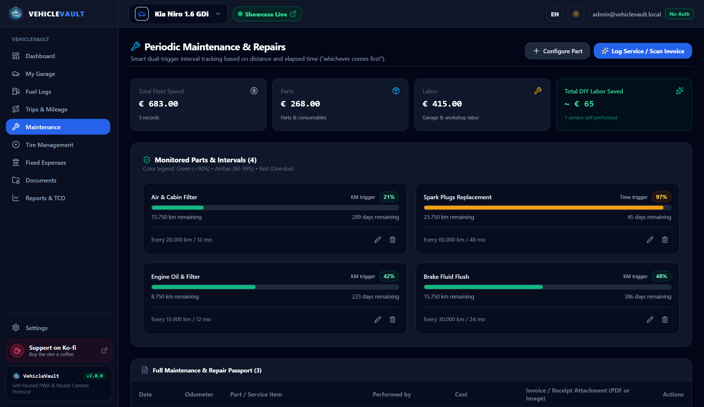
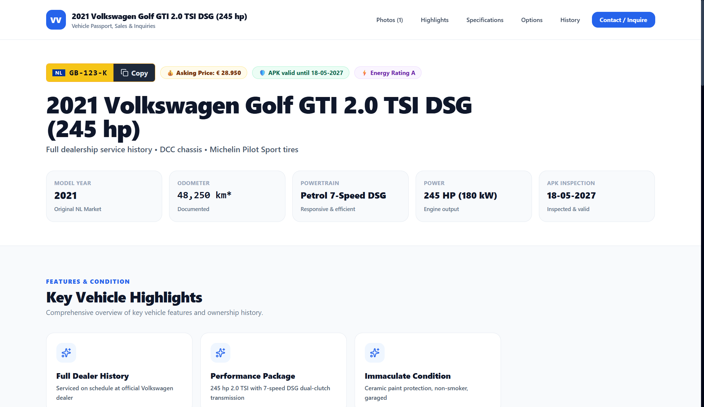
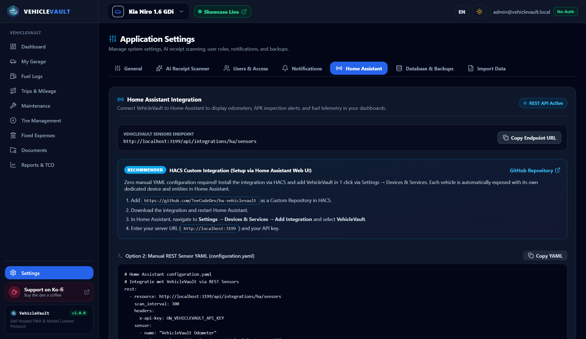

<div align="center">
  
  <h1>VehicleVault</h1>
  <p><strong>Self-Hosted Vehicle Lifecycle, Fuel, Maintenance, Digital Glovebox, and TCO Platform</strong></p>

  [](LICENSE)
  [](server/src/tests/vehiclevault.test.ts)
  [](https://nodejs.org/)
  [](https://www.typescriptlang.org/)
  [](https://react.dev/)
  [](https://www.docker.com/)
  [](https://www.home-assistant.io/)
  [](https://modelcontextprotocol.io/)
  [](https://ko-fi.com/D1D51ZGUNL)
</div>

---

**VehicleVault** is a privacy-first, self-hosted vehicle lifecycle, fueling, maintenance, and Total Cost of Ownership (TCO) management platform. Built with **React 19**, a **Node.js 24 TypeScript REST API**, an **AI Vision & Tesseract OCR parsing pipeline**, a native **Home Assistant integration**, and a **Model Context Protocol (MCP) Server** enabling AI agents (such as Claude Desktop or Antigravity) to read and log vehicle telemetry.

---

## 📸 Screenshots

<div align="center">
  <h3>Fleet Dashboard &amp; TCO Analytics</h3>
  
  <br/><br/>
  
  <h3>AI Vision Receipt Scanner (Google Gemini &amp; OpenAI Vision)</h3>
  
  <br/><br/>

  <h3>Dual-Trigger Maintenance Engine (Distance &amp; Time Intervals)</h3>
  
  <br/><br/>

  <h3>Public Sales Showcase &amp; Standalone Website Dossier Export</h3>
  
  <br/><br/>

  <h3>Home Assistant REST Sensors &amp; Lovelace Telemetry</h3>
  
</div>

---

## ✨ Features

### 🚘 Fleet & Vehicle Management
- **Multi-Type Support:** Passenger Cars, Motorcycles, Commercial Vans, Trailers, and Heavy Trucks.
- **Visual Multi-Photo Gallery:** Upload and categorize exterior, interior, engine bay, and wheel photos with sort order and primary cover photo sync.
- **Dutch RDW Open Data Integration:**
  - One-click auto-fill for Dutch license plates via the official Open Data RDW API.
  - Automatically imports Make, Model, Fuel type, Power (kW/PK), Curb weight, and APK dates.
  - Periodic background sync of APK inspection dates with automatic alert badges for due soon (< 30 days) and overdue statuses.

### ⛽ Fueling, EV Charging & AI Vision Scanner
- **Fast Mobile PWA UI:** Optimized for quick logging directly at the fuel pump or charging station.
- **AI Vision Receipt Scanner:** Powered by **Google Gemini** or **OpenAI Vision** with local **Tesseract OCR** fallback. Automatically detects Date, Liters, Unit Price (€/L), Total Cost (€), Fuel Type, Gas Station Name, and Address.
- **Existing Fill-Up Re-Scan:** Re-read and populate data from previously uploaded receipts on existing fuel entries at any time.
- **PHEV & EV Support:** Dedicated logging for electric vehicles and plug-in hybrids tracking kWh charged and electricity rates (€/kWh).
- **Nearby Gas Station GPS:** Built-in GPS geolocation and search engine discovering nearby fuel stations with real-time distance calculations.

### 🛠️ Dual-Trigger Maintenance Engine
- **Whichever Comes First:** Distance (e.g. 15,000 km) and Time (e.g. 12 months) intervals governed by dual-trigger logic.
- **Visual Health Bars:** Clean color-coded indicators: Green (<90%) ➔ Amber (90–99%) ➔ Red (Overdue).
- **Parts vs. Labor Cost Split:** Differentiate workshop labor charges from parts replacement costs.
- **DIY Savings Benchmark:** Flag self-performed maintenance to track accumulated money saved across your fleet.
- **PDF Service Dossier:** Generates a publication-ready vector PDF service booklet ideal for car sales or insurance valuations.

### 🛞 Tire Set Management & Safety Limit Alerts
- **Seasonal Tire Sets:** Manage Summer, Winter, and All-Season tire sets.
- **Safety Tread Depth Alerts:** Track tread depth per tire (LF, RF, LR, RR) with automatic warnings (< 3.0 mm) and legal minimum alerts (< 1.6 mm).
- **Technical Specifications:** Dedicated fields for Brand, Model, Rim Size (e.g. 17"), DOT production code, and Load/Speed Index (e.g. 92V).
- **Mount & Swap History:** One-click mount/unmount tracking calculating distance driven per set.

### 🚗 Trip Logging & Belastingdienst Fiscal Dossier
- **Fiscal Trip Registration:** Compliant with the Dutch Tax Authority (Belastingdienst) requirements.
- **Classification:** Business, Commute, and Private trip tracking with departure/arrival locations and route descriptions.
- **Multi-Format Exports:** 1-click export to official semicolon-delimited CSV, styled Excel (.xlsx) workbooks, and vector PDF fiscal dossiers.

### 💸 Recurring Expenses & Fixed Costs TCO
- **Recurring Fixed Costs:** Monthly/annual road tax (motorrijtuigenbelasting), vehicle insurance, roadside assistance, parking permits, and subscriptions.
- **True TCO Calculation:** Computes Total Cost of Ownership per kilometer and per month, with a toggle to include or exclude vehicle purchase price.

### 🌐 Public Sales Showcase & Standalone Website Export
- **Public Vehicle Passport:** Shareable, mobile-responsive sales showcase page with pricing, vehicle highlights, verified maintenance history, and contact options.
- **1-Click Standalone Website ZIP:** Exports a complete, static HTML5/CSS3/JavaScript website with all optimized images, ready to host on GitHub Pages, Cloudflare Pages, or an Apache/Nginx webserver without any backend.

### 🏠 Home Assistant Integration
- **REST Sensor Telemetry:** Exposes active vehicle telemetry (odometer, APK expiration days, status, fuel averages) formatted for Home Assistant `rest` sensors.
- **HACS Custom Integration:** Compatible with custom Home Assistant repository integration.

### 🤖 Model Context Protocol (MCP) Server
- **AI Assistant Integration:** Connect Claude Desktop, Antigravity, or custom autonomous agents to your vehicle vault.
- **Stdio & HTTP Transports:** Supports local command-line stdio execution or secure HTTP/SSE with hashed API keys (`vkv_...`).
- **Available MCP Tools:** `list_vehicles`, `get_vehicle_summary`, `log_fuel_entry`, `log_service_entry`, `check_maintenance_alerts`.

### 👥 Multi-User Roles & Vehicle Sharing
- **Role-Based Access Control:** `Admin` (full system access), `User` (standard vehicle owner), and `Driver` (simplified mobile-friendly interface for fuel logging).
- **Vehicle Sharing:** Share specific vehicles between household members or co-drivers with Editor or Viewer permissions.
- **Single Sign-On (SSO):** Optional integration with reverse proxies (Authelia, Authentik, Pangolin, Cloudflare Access, Traefik).

### 🔔 Push & Email Notifications
- **Automated Alerts:** Dispatches reminders when APK inspections are approaching (< 30d, < 7d) or when maintenance is due.
- **Multiple Providers:** Native support for **Ntfy**, **Gotify**, **Custom Webhooks**, and **SMTP Email**.

### 💾 1-Click Database & File Backup / Restore
- **Consistent Backups:** Creates a complete ZIP archive of `vehiclevault.db` (using safe SQLite WAL checkpoints) and all uploaded receipts, invoices, and documents.
- **Safe Restore:** 1-click restore with automatic `.bak` safety fallbacks.

---

## 🚀 Quick Start with Docker

The fastest way to deploy VehicleVault is with Docker Compose.

### 1. Clone the Repository
```bash
git clone https://github.com/TeeCodeDev/VehicleVault.git
cd VehicleVault
cp .env.example .env
```

### 2. Configure Secrets in `.env`
Generate two secure keys for authentication:
```bash
# On Linux/macOS
openssl rand -hex 32
```
Paste the generated secrets into `JWT_SECRET` and `JWT_REFRESH_SECRET` in `.env`.

### 3. Launch the Stack
```bash
docker compose up -d
```

Visit **`http://localhost:3001`** in your browser.
The first account registered automatically receives **Administrator** rights.

All persistent files (SQLite database, vehicle photos, receipt scans, documents, and invoices) are stored in `./data`.

---

## 🛠 Tech Stack

| Layer | Technology | Purpose |
|---|---|---|
| **Frontend** | React 19, TypeScript, Vite, Tailwind CSS | High-density responsive SaaS design system with native dark/light theme |
| **Backend API** | Node.js 24 LTS, TypeScript, Express | Modular REST API with Zod validation, rate limiting, and Helmet headers |
| **Database** | SQLite 3 with WAL Mode (`better-sqlite3`) | Embedded, zero-configuration database stored in `/data/vehiclevault.db` |
| **Visualizations** | Recharts | Interactive SVG charts for TCO, fuel trends, and monthly spend |
| **AI Vision & OCR** | Google Gemini, OpenAI Vision, Tesseract.js | Multimodal AI receipt scanning with local Tesseract fallback |
| **PDF & Excel** | PDFKit, ExcelJS | Vector PDF maintenance dossiers and formatted Excel trip workbooks |
| **MCP Protocol** | `@modelcontextprotocol/sdk` | Official SDK exposing vehicle telemetry tools to AI agents |

---

## 🤖 Model Context Protocol (MCP) Setup

Add VehicleVault to your `claude_desktop_config.json`:

```json
{
  "mcpServers": {
    "vehiclevault": {
      "command": "node",
      "args": ["/absolute/path/to/VehicleVault/server/dist/mcp/stdio.js"],
      "env": {
        "DATA_DIR": "/absolute/path/to/VehicleVault/data"
      }
    }
  }
}
```

Or connect via HTTP using an API key created in **Settings ➔ API-sleutels**:
```bash
curl -H "X-API-Key: vkv_YOUR_KEY" http://localhost:3001/api/mcp/tools
```

---

## 💻 Local Development & Testing

```bash
# 1. Install workspace dependencies
npm install

# 2. Run automated test suite (61/61 tests passing)
npm test

# 3. Build both client and server
npm run build

# 4. Start production server
npm start
```

For hot-reloading during development:
```bash
npm run dev:all
```

---

## 🛡️ Security & Privacy

- **Zero Telemetry / Self-Contained:** No tracking, analytics, or third-party cookies.
- **JWT & HTTP-Only Cookies:** Short-lived access tokens paired with `SameSite=Lax` secure refresh cookies.
- **Hashed Secrets:** Passwords hashed with bcrypt; API keys and tokens hashed with SHA-256.
- **Path Traversal Protection:** All file upload and download endpoints strictly sanitize paths with `path.basename`.
- **Health Checks:** Diagnostic endpoint available at `/healthz`.

---

## ☕ Support the Project

If VehicleVault helps you manage your vehicles, track your fuel expenses, or streamline your vehicle maintenance, consider supporting development on Ko-fi!

<div align="center">
  <a href="https://ko-fi.com/D1D51ZGUNL" target="_blank">
    
  </a>
</div>

---

## 📄 License

VehicleVault is open-source software licensed under the [MIT License](LICENSE).
